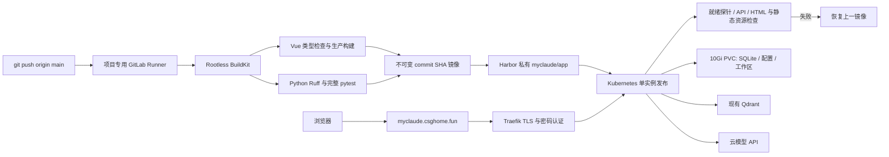

# GitLab 部署与运维

代码仓库：<https://gitlab.csghome.fun/csg/myclaude>（私有）。
服务器入口：<https://myclaude.csghome.fun/>，HTTPS + 独立 Basic Auth。
独立域名解析到 101.96.204.240，Traefik 直接路由根路径，证书由 cert-manager 自动续期。登录凭据保存在本机被 Git 忽略的 `.local/deploy/access.json`，不进入仓库或镜像。

## 发布链路



`.gitlab-ci.yml` 在 `main` 上自动执行；构建的 Dockerfile 必须完成 Python 测试和 Vue 构建后才能生成最终镜像。发布按 `myclaude-production` 串行执行；每次升级前在 PVC `/data/backups/<UTC时间>/` 使用 SQLite backup API 备份数据库及配置；失败后任务仍标记失败，同时回退至上一个 Deployment revision，恢复镜像及容器环境等完整模板。首次发布没有旧镜像可恢复。默认分支受保护，禁止强制推送。

## 隔离与凭据

- `myclaude-ci`：独立 Runner 和构建任务，默认构建账号没有 Kubernetes 资源权限。发布任务切换到 `myclaude-deploy`，只获得 `myclaude` 命名空间所需的 Deployment、Service、Pod 读取/执行权限。
- `myclaude`：单实例应用、10Gi `local-path` PVC、Ingress 和 Secret。SQLite 使用 `Recreate` 发布，升级有短暂不可用窗口。
- 应用容器以 UID 1000 运行，不挂载 Kubernetes ServiceAccount 令牌，不拥有 Docker Socket 或宿主机目录；Agent 默认权限仍为只读。
- GitLab 的 Harbor 与构建代理变量均受保护，密码变量被遮罩。模型 Key 通过 Kubernetes Secret 首次初始化到 PVC 中的 `settings.json`，后续网页保存直接写 PVC。更新 Secret 不会覆盖已存在的设置。
- 公网 Basic Auth Secret 名为 `myclaude-auth`。它是入口认证，不是模型 API Key。不要把 `.local/deploy`、`.env` 或服务器 Secret 导入 Git。
- 服务器使用 `qdrant.qdrant.svc.cluster.local:6333`，集合 `myclaude_server_v1`，独立于本机学习集合。

## 日常操作

```powershell
cd C:\csg\work\project\myCalude
git add <需要提交的文件>
git commit -m "描述修改"
git push origin main
ssh -p16022 csg@101.96.204.240
```

服务器上：

```sh
kubectl -n myclaude get pods,pvc,ingress
kubectl -n myclaude logs deployment/myclaude --tail=100
kubectl -n myclaude rollout history deployment/myclaude
kubectl -n myclaude rollout undo deployment/myclaude
kubectl -n myclaude rollout status deployment/myclaude --timeout=180s
```

手工回滚只切换代码镜像，不回滚数据。未来涉及破坏性数据库迁移时，应先备份 SQLite、`settings.json`、插件目录和工作区，再执行迁移。`local-path` 的 Retain 策略并不等于异机备份。

`deploy/kubernetes.yaml` 是流水线管理的应用资源；`deploy/infrastructure.yaml` 记录预置的非敏感资源。重建环境前还需创建命名空间、Runner 配置、模型配置、镜像拉取凭据和入口认证 Secret。不要直接导出含 Secret 的整套集群配置到仓库。

## 模型配置

登录页面后进入“设置”，可编辑主模型、备用路由和 Embedding；连接测试会实际调用对应服务。普通 Agent 对话只需要主 LLM；知识库检索需要 Embedding 和 Qdrant。已有本机云模型配置会在首次部署时安全复制，之后本机和服务器各自独立保存。

## 范围说明

CI/CD 自动发布不代表 Rust 全部行为已经逐项等价。功能迁移和仍未完成的兼容项以 [全量迁移进度](全量迁移进度.md) 为准。

真实流水线、模型、检索和访问保护的验证见 [部署验收记录](部署验收记录.md)。

独立域名的 HTTP 入口会跳转 HTTPS；旧 `https://gitlab.csghome.fun/myclaude/` 跳转新域名。新 TLS Secret 为 `myclaude-domain-tls`，由 cert-manager 的 letsencrypt-production 自动续期。
