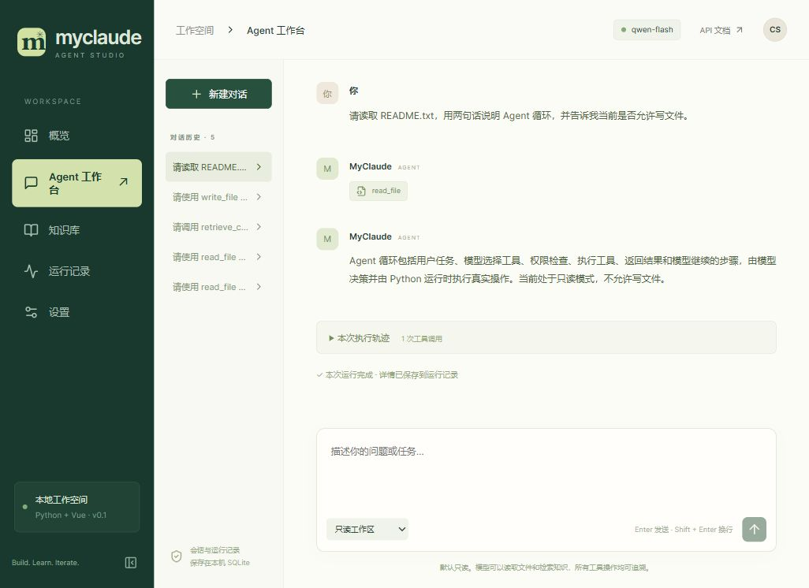
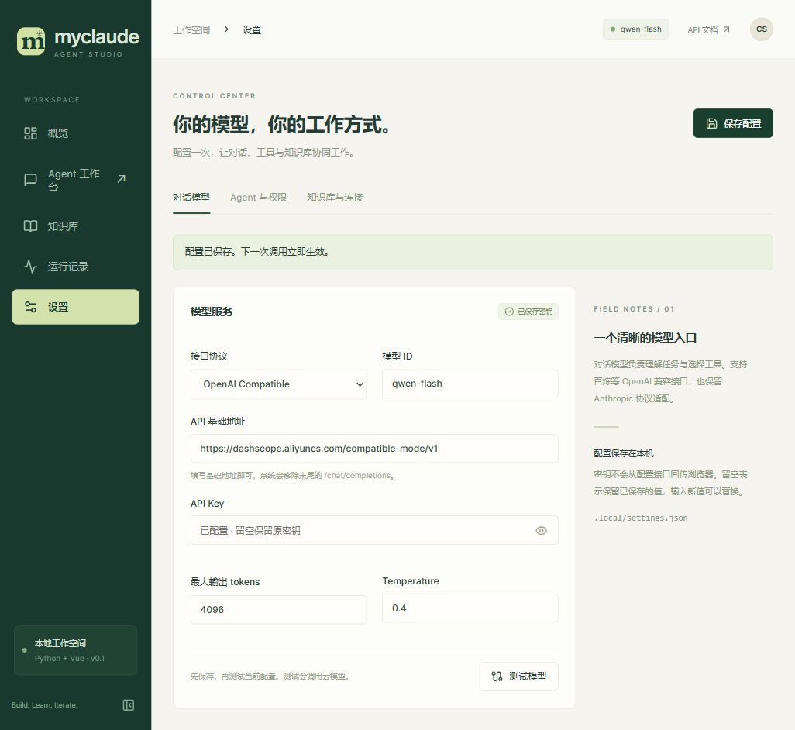
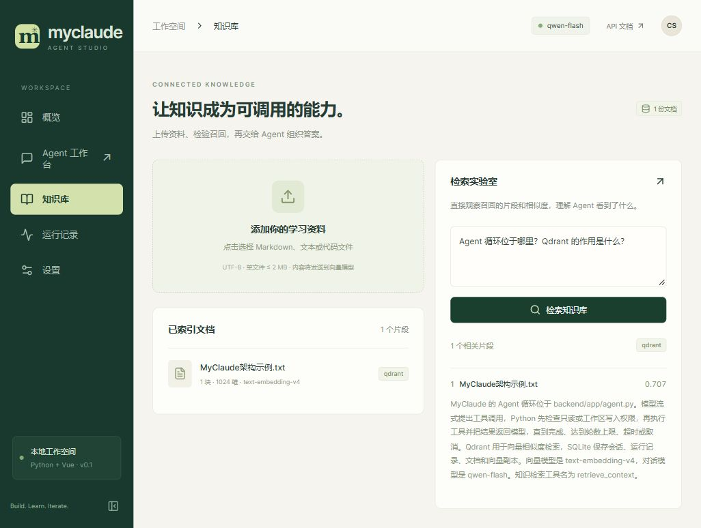

# MyClaude 使用指南

MyClaude 把模型对话、文件工具和知识库放在同一个本地网页中，适合边使用边学习 Agent 开发。本文说明当前交付版本的启动、配置与日常操作。默认服务地址是 `http://127.0.0.1:8000`，代码位于 `C:\csg\work\project\myCalude`。

## 启动与停止

当前依赖已经安装，前端已构建，应用已启动。日后重新启动：

```powershell
cd C:\csg\work\project\myCalude
.\start.ps1
```

打开 [MyClaude](http://127.0.0.1:8000)。脚本在后台启动 Python 服务；重复执行会复用记录中的存活进程。没有设置开机自启。关闭浏览器不会关闭服务。

```powershell
# 优雅停止服务、任务、MCP/SSH 子进程，并运行插件 Shutdown
.\stop.ps1

# 首次安装或在另一台 Windows 电脑上部署
.\install.ps1
.\start.ps1
```

需要 Python 3.11 或更高版本、Node.js 和 npm、系统 OpenSSH 客户端。本次实际环境为 Python 3.11.9、Node.js 24.14.1。Python 使用项目 `.venv`，不修改其他项目依赖。`install.ps1` 优先使用 Python 锁定依赖和 `npm ci`。

如当前 PowerShell 禁止执行脚本，可用 `powershell -NoProfile -ExecutionPolicy Bypass -File .\start.ps1`，只对该进程生效。

## 页面说明

| 页面 | 可以完成什么 |
| --- | --- |
| 概览 | 查看会话数、运行数、知识片段数、累计 tokens 和最近运行 |
| Agent 工作台 | 新建和恢复对话、流式回答、选择只读、写入或执行权限、停止生成、展开本次工具轨迹 |
| 知识库 | 上传文档进行切块和向量化，直接检索片段，查看实际检索后端及分数 |
| 运行记录 | 查看每次运行的状态、轮数、用量、工具参数和执行结果 |
| 扩展中心 | MCP 配置和连接发现、插件安装启停、工具实验室、迁移目录 |
| 任务与协作 | 后台 Agent、并行团队、定时任务、待回答问题与任务结果 |
| 会话与运行时 | JSON/JSONL、会话分支与摘要、Skills/Agent、OAuth、参数权限规则与诊断 |
| 设置 | 配置对话模型、提示词、工作区、预算、向量模型、Qdrant 与 SSH 隧道 |



## 配置模型

当前已从你提供的根目录 `.env` 导入 `LLM_URL`、`LLM_MODEL`、`LLM_API_KEY`。原文件未修改。导入只发生在首次创建 `.local/settings.json` 时；之后网页配置文件优先，修改 `.env` 不会自动覆盖已保存的设置。

| 用途 | 当前值 |
| --- | --- |
| 对话模型 | `qwen-flash` |
| 对话协议 | OpenAI Compatible |
| 对话基础地址 | `https://dashscope.aliyuncs.com/compatible-mode/v1` |
| 向量模型 | `text-embedding-v4`，实测 1024 维 |
| 向量基础地址 | 同一百炼兼容地址 |
| Qdrant HTTP 地址 | `http://127.0.0.1:17333`，由 SSH 转发 |
| 本项目独立集合 | `myclaude_learning_v1` |

对话模型负责理解任务、决定工具调用与组织回答；向量模型负责把文档和查询转成向量。Qdrant 是数据库，不是大模型。当前功能不需要语音模型、图像模型或重排模型，因此没有导入原 `.env` 的 ASR、TTS 配置。

在「设置 → 对话模型」中填写模型 ID、基础地址和 API Key，点击「保存配置」，再点击「测试模型」。测试使用已保存配置并发起一次小规模真实请求。`qwen-flash` 默认输出上限为 4096，后端同时防止超过已验证的 32768 上限。

API Key 输入框留空会保留原值，填写新值会替换。配置 GET 接口只返回 `api_key_set` 等状态，不返回密钥原文。需要删除密钥时可关闭服务后编辑 `.local/settings.json` 对应字段为空，再重启。该文件在本机以明文保存并被 Git 忽略；它没有额外加密。

Anthropic 协议适配也已实现，并通过模拟流式测试；当前真实云服务验证使用的是百炼，不能据此声称所有供应商或模型均已验证。



## 使用文件工具

默认工作区为 `C:\csg\work\project\myCalude\workspace`。可以在设置里改为另一个已存在的目录；切换目录后建议新建对话，避免旧上下文与新文件混淆。

在 Agent 工作台输入：

```text
请读取 README.txt，解释里面的 Agent 循环。
```

查看回答下面的执行轨迹，应看到 `read_file` 的真实结果。仅模型说“读过了”不能证明文件工具执行过。

想让 Agent 写代码时，在输入框左下方选择「允许工作区写入」，再明确提出任务：

```text
请创建 examples/hello.py，写一个 greet(name) 函数，然后读回文件检查内容。
```

`write_file` 可以创建目录和覆盖文件；切回只读后，该工具不再向模型提供，执行器也会拒绝它。选择「允许执行（本机进程）」后，可用 PowerShell、bash、REPL 实际运行代码；“读回检查”仍不等于运行测试。执行权限没有 OS 沙箱，不受文件工具工作区限制。

所有文件路径必须相对工作区。运行时拒绝绝对路径、`..`、越界符号链接以及 `.env`、`.local`、`.git`、`.ssh`、密钥后缀等路径。文件权限检查是应用级约束，不是操作系统沙箱；不要让其他进程在同一目录里并发改变符号链接。

## 使用知识库

1. 打开「知识库」，选择一份 UTF-8 文本、Markdown 或代码文件。支持扩展名显示在文件选择器中；不支持 PDF、Word 和图片解析。
2. 文档内容将发送给配置的云向量模型。单文件不超过 2 MB，单次最多 256 个片段；更大的资料请拆分。
3. 上传成功后，页面显示片段数和维度。资料同时保存到本机 SQLite 与本项目的 Qdrant 集合。
4. 在右侧「检索实验室」输入问题，检查来源、片段与分数。显示 `qdrant` 表示实际使用远程检索；`sqlite-fallback` 表示 Qdrant 暂不可用或集合无匹配点，结果来自本机向量副本。
5. 回到 Agent 工作台，让模型使用知识：`请调用 retrieve_context 检索 Agent 循环的位置，并引用文档名称回答。`

目前已放入一份简短的公开架构示例和工作区 README，用于验证链路；整个 Rust 仓库和本项目源码尚未自动入库。重复上传会产生独立文档，不做自动去重。当前网页未提供文档删除、编辑或重建管理。

改变 embedding 模型或地址后，旧文档通过模型标识隔离，不会混入新查询。若维度不同，需要新建 `myclaude_` 前缀的集合并重新上传。修改集合名称不会自动把旧集合的数据复制过去。



## 远程 Qdrant 与 SSH

本项目的 SSH 隧道由 Python 后端按需启动，独立于之前 Rust 版的隧道：

```text
本机 127.0.0.1:17333
    → SSH csg@101.96.204.240:16022
    → Kubernetes Service 10.111.180.35:6333
```

后端使用 Qdrant HTTP API，因此连接远端 6333，不使用 Rust 版的 gRPC 6334。隧道依赖本机已有的 SSH 密钥登录与可信主机记录；不在网页里保存 SSH 密码或私钥。Qdrant API Key 仅用于该数据库认证。

在「设置 → 知识库与连接」可以修改 SSH 主机、端口、远程服务地址和本机转发端口。修改本机端口后，也要让 Qdrant HTTP 地址指向相同端口。集群 Service 被重建而换 IP 时，应更新远程服务地址。

## 运行状态与停止

| 状态 | 含义 |
| --- | --- |
| completed | 模型正常结束本次回答 |
| limit | 达到最大轮数或输出上限，不能视为任务已完成 |
| timeout | 超过整次 Agent 运行的时间限制 |
| cancelled | 用户停止或客户端断开 |
| failed | 模型接口、参数或其他执行错误导致运行结束 |
| interrupted | 服务重启时发现上次仍标记为运行中 |

停止生成会终止后续请求，但不会撤销已经执行的文件写入。切离聊天页面也会断开正在进行的聊天请求。取消或失败的半轮内容不作为下一轮模型上下文；工具操作与已收到的事件仍留在运行记录里。

Tokens 来自模型返回的实际用量，不估算金额。若流式请求在用量事件返回前被取消，此次 tokens 可能没有记录全，不能把界面总数当成服务商账单。

## 命令行入口

CLI 独立运行 Python Agent，使用同一份配置和会话存储，不要求先启动网页服务：

```powershell
cd C:\csg\work\project\myCalude
.\myclaude.ps1 -p "请列出当前工作区文件"
.\myclaude.ps1 --resume "已有会话ID" -p "继续解释刚才的代码"
.\myclaude.ps1 --output-format stream-json -p "解释 Agent 的循环"
.\myclaude.ps1 status
.\myclaude.ps1 session list
.\myclaude.ps1 export latest --format jsonl --output session.jsonl
.\myclaude.ps1 import session.jsonl
.\myclaude.ps1 skills list
.\myclaude.ps1 agents list
.\myclaude.ps1 config inspect
```

无参数且在交互终端运行时进入 REPL，`/exit` 退出。`--cwd` 指定工作区，`--data-dir` 指定独立数据目录，`--permission-mode` 选择权限，`--allowed-tools` 指定逗号分隔的工具名单。`--reasoning high` 只适用于支持 `reasoning_effort` 的 OpenAI 兼容服务。`--base-commit SHA` 会检查启动基线并输出不一致提示。

CLI 进程退出时会清理自己创建的后台任务；需要关闭终端后继续工作的任务，请在网页“任务与协作”创建。网页和 CLI 可以使用不同会话，同一会话的执行通过 SQLite 互斥。0.4 的恢复流程使用 PID 和进程创建标识，只恢复死亡执行器的记录，不再把仍运行的 CLI 误标为 interrupted。

## 开发与排错

前后端开发时可分别在两个终端运行：

```powershell
# 终端一，项目根目录；先停止后台版本，避免端口冲突
.\stop.ps1
.\.venv\Scripts\python.exe -m uvicorn app.main:app --app-dir backend --reload --host 127.0.0.1 --port 8000

# 终端二
cd frontend
npm.cmd run dev
```

开发页面在 `http://127.0.0.1:5173`，Vite 把 `/api` 转发给 Python。开发完成执行 `npm.cmd run build`，再重启后台版本。修改 Python 代码后也需要重启后台服务。

| 现象 | 检查方法 |
| --- | --- |
| 8000 端口被占用 | 查看是否已有本项目服务；启动脚本不会结束其他占用者 |
| 模型 HTTP 401 或 403 | 检查 Key、服务权限、模型和基础地址是否属于同一服务 |
| 模型 HTTP 400 | 检查模型是否支持工具调用及传入参数，降低输出上限 |
| SSH 连接失败 | 在终端验证已有密钥能否登录，再检查 known_hosts 和集群服务地址 |
| 向量维度不匹配 | 改用新的集合名，使用一致的 embedding 配置重新上传 |
| 更改模型后检索无结果 | 文档按向量模型身份隔离，需要在新配置下重新入库 |
| 写文件被拒绝 | 检查聊天输入区权限、相对路径、工作区范围及凭据目录过滤 |
| 首次启动显示未构建 | 进入 frontend 执行 `npm.cmd run build` 并重启服务 |

服务日志在 `.local/server.stderr.log`；配置在 `.local/settings.json`；数据在 `.local/app.sqlite`。备份时先停止服务，再保存整个 `.local` 和自己的工作区文件。应用定位为本机单用户学习工具，绑定 loopback，尚未实现用户登录与多租户权限。


## MCP、插件、协作与命令

v0.2 新增「扩展中心」和「任务与协作」。前者管理 MCP、插件/hooks，提供直接工具调用实验室和真实迁移状态；后者管理后台 Agent、并行团队、UTC 定时任务以及子 Agent 的待回答问题。

先按 [扩展开发与学习](扩展开发与学习.md) 跑自带示例。学习 MCP 和插件本身不需要额外模型，只有让 Agent 自动选择工具、创建子 Agent 时才会调用已配置的对话模型。所有子 Agent 默认复用当前连接；向量模型仍只用于知识库。

聊天框支持 `/help`、`/status`、`/model`、`/permissions`、`/mcp`、`/plugin`、`/tasks` 等命令。命令既有本地操作、页面跳转，也有交给模型执行的工作流；不把上游占位命令算作已经实现。详细兼容范围见 [迁移矩阵](迁移矩阵.md)。

```powershell
# CLI 命令查询，不调用模型
$env:PYTHONPATH = "backend"
.\.venv\Scripts\python.exe -m app.cli "/status"
```

默认只读；写入、脚本执行分别选择相应权限。执行权限会允许本机进程，不是容器沙箱。后台任务关闭页面后继续运行；停止生成只停止当前前台运行，独立任务请在任务页逐项停止。

配置和数据的备份仍是 `.local` 加工作区。新增的 MCP、插件、任务、团队和定时元数据都在 SQLite；插件实际文件在 `.local/plugins`。`stop.ps1` 优先请求优雅停止，等待清理后退出；异常时仅清理记录中的本项目进程树。

## 会话、OAuth 与运行时设置

“会话与运行时 → 会话迁移”支持 Rust JSON/JSONL 导入、导出、创建分支和压缩早期历史。导入会创建新副本；工作区不匹配默认拒绝。压缩按工具调用/结果边界保留最近消息，为旧上下文生成确定性摘要，不调用额外摘要模型。执行中不允许压缩。

“技能与 Agent”可以安装本机 SKILL.md 或完整技能目录，辅助文件一并保留。项目定义优先于用户定义，支持 `.claw/skills`、`.claude/skills`、`workspace/skills` 和 `.local/skills`。新 Agent 定义写入当前工作区 `.claw/agents/*.toml`。在工作台使用 `/agents run NAME 任务`，需要执行权限；默认复用当前模型连接。

现有 API Key 配置继续可用，不必改成 OAuth。要使用支持 OAuth 的云服务，在页面填写其授权端点、令牌端点、client ID、scopes 和回调地址；点击开始授权并打开链接。回调成功后，在“工具策略”将认证方式切换为 OAuth。使用 PKCE 和短期 state，令牌只保存在 `.local/credentials.json`，页面不返回令牌。这里尚未使用用户真实 OAuth 云服务验证，也不是 MCP 服务的 OAuth discovery。

工具策略可配置允许/拒绝名单、参数规则、全局 Hooks、LSP 命令、模型重试次数和推理强度。例如参数规则：

```json
{"deny":["bash(rm:*)"],"ask":["write_file(*)"]}
```

规则先检查 deny，再 allow，再 ask；规则不能扩大当前会话的最高权限。`bash(rm:*)` 只是前缀规则示例，不能识别所有等价 shell 写法，也不替代 OS 隔离。Hooks 是可执行扩展，仅在执行权限下运行。一个全局 Hook 示例：

```json
{"PreToolUse":[{"matcher":"write_file|edit_file","command":["$python","C:/path/to/check.py"],"timeout":20}]}
```

Hook 从 stdin 读取 JSON；exit 2、`continue:false`、`decision:block` 或 `hookSpecificOutput.permissionDecision:deny` 会阻止操作。`updatedInput` 修改后的参数会再次校验；`permissionDecision:ask` 等待页面/交互 CLI 的一次确认。

“运行时诊断”提供恢复仿真、真实 Git 分支查询、模块冲突、策略求值、报告标准化和显式单价计算。恢复和策略的结果是决策记录，不会自动重启、rebase、合并或推送。下方可以预览原项目五层配置及覆盖来源；导入遇到未映射字段时会拒绝并列明。

## 把 Python 工具暴露给其他 MCP 客户端

将客户端 stdio 配置设为项目虚拟环境的 Python，参数为 `-m app.mcp_server --workspace C:/csg/work/project/myCalude/workspace`，并设置 `PYTHONPATH=C:/csg/work/project/myCalude/backend`。默认只读，可使用 `--data-dir` 指定独立数据目录。协议支持 JSON lines 和原 Content-Length 帧；工具执行复用同一权限与路径校验。

完整迁移现状及仍需完成的模块见 [全量迁移进度](全量迁移进度.md)，不要把“可以点击”理解为“全部行为已兼容”。


## 0.5 服务器入口与兼容配置

访问 https://myclaude.csghome.fun/，使用独立入口账号；本机凭据文件是 `.local/deploy/access.json`。这不是模型 API Key。进入“设置”配置主 LLM；知识库还需要 Embedding 和 Qdrant。云 Key 留空保存会保留原值，前端不回显明文。

“运行时 → 诊断 → Bash 命令分类”只分析命令，不执行命令。“设置 → 插件发现与模型连接”支持自定义安装目录和原版 installed.json 路径；修改存储路径后重启服务。通过原配置的 `plugins.maxOutputTokens` 可以覆盖模型输出上限。

CLI 导出现在遵守原版位置参数含义：

```powershell
.\myclaude.ps1 export transcript.md --session latest
.\myclaude.ps1 export --session latest --format json --output session.json
.\myclaude.ps1 --compact prompt "解释这个项目"
```

JSON/JSONL 是可恢复的会话数据；Markdown 用于阅读和分享。配置导入支持 env、mcpServers 与 oauth，保存到私有 settings.json；不要把该文件提交到 Git。OAuth 页面会读取导入的默认配置，实际厂商登录仍使用你配置的 Client ID 和授权端点。


## 0.6 Worker 观察与 CLI 参数

工具实验室中的 WorkerCreate 创建持久会话；WorkerObserve 接收终端观察文本，WorkerAwaitReady 返回就绪快照（不阻塞等待）。就绪后 WorkerSendPrompt 启动真实后台 Agent；通过 WorkerGet/任务面板看结果。WorkerRestart/WorkerTerminate 会取消正在运行的任务。终端文本只能作为观察证据，不能用 WorkerObserveCompletion 覆盖尚未结束的真实任务。

工作区 `.claw/worker-state.json` 为原版兼容观察文件，每次状态事件原子替换；多个 Worker 共享此文件，逐个查询请用工具/API。文件写入失败不会导致任务失败，SQLite 是持久状态来源。

CLI 可以重复指定 `--allowedTools read_file --allowed-tools search_files`，列表合并去重。`-p -- "--literal prompt"` 将以连字符开头的内容作为提示词。`--base-commit` 接受 7–64 位十六进制 SHA；参数错误返回非零退出码，JSON 模式提供 `error_kind`、`hint`、`action` 和 `exit_code`。`config show` 显示脱敏配置，参数错误会在加载配置或请求模型前被拒绝。
