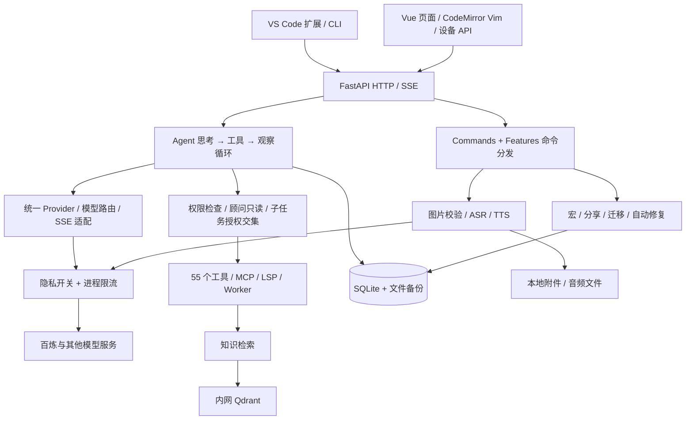

# 0.8 完整功能使用与验收

本轮在 0.7 的 Rust 功能迁移基础上，进一步实现用户指定的 25 个原版占位命令。冻结基线为 `08106b0c3771ef5b4a5aa176acccd460e88b7325`：55 个工具、140 个命令均有 Python 执行或 Vue 交互入口；其中 17 个命令本质上是 Agent 提示工作流。原 catalog 的 `implemented:false` 是原版元数据，不代表 Python 状态。逐项范围见《迁移矩阵》。

## 入口和操作

| 命令 | 实际行为与网页入口 |
| --- | --- |
| `/vim on/off` | CodeMirror Vim 编辑器；Esc 普通模式、i 插入、dd 删除行。功能工作台 → 编辑与设备。CLI 保存与网页共用的偏好。 |
| `/keybindings` | 显示快捷键；传 JSON 保存 send/new/stop/focus；reset 恢复。默认 Enter 发送，Shift+Enter 换行。 |
| `/voice on/off` | 保存语音模式；网页开启时启动录音；录音结束先转为可编辑草稿，再由用户发送。 |
| `/listen [WAV路径]` | 网页麦克风录音，最长 60 秒；有路径时服务端读取工作区 8/16 kHz、16 bit、单声道 WAV 并真实识别。 |
| `/speak [文本]` | 默认朗读最后一条助手回答，也可指定 1–3000 字符；每 300 字分段合成并拼接 WAV，网页可播放。 |
| `/image [图片路径]` | 网页上传或 CLI 读取工作区图片；PNG/JPEG/WebP，5 MB、1600 万像素以内，移除元数据后保存。最多附加 4 张图片，下一条对话真正发送图片内容。 |
| `/screenshot` | 浏览器选择屏幕/窗口，捕获单帧加入待发送附件，随后释放屏幕共享。支持取决于浏览器设备 API。 |
| `/advisor on/off` | 顾问模式；后端强制 Agent 只读，即使请求声明允许写入也不能提权。 |
| `/stickers` | 打开文本/Emoji 贴纸；JSON 添加自定义包；remove ID 删除；选择后加入草稿。 |
| `/notifications on/off` | 持久化站内运行完成通知；网页可额外授权桌面通知、标记已读、关闭桌面通知。不发送外部消息。 |
| `/share [create [小时数]]` | 1–168 小时只读会话快照；仅文字消息、脱敏、省略工具和图片；list 查看，revoke ID 撤销。分享仍需要网站 BasicAuth，不会绕过站点登录。 |
| `/feedback 文本` | 保存本地反馈，list 查看；功能工作台可标记解决。不会发送给供应商。 |
| `/alias set 名称 /命令` | 保存并实际展开自定义命令别名；防止覆盖内置命令和循环；list/remove 管理。 |
| `/macro record 名称` | 记录当前会话之后成功执行的命令；stop 结束；run 名称按顺序重放；show/list/remove 管理。最多 32 步，继承权限，遇错停止，不允许嵌套宏或自动录制设备选择。 |
| `/privacy-settings` | 查询或 JSON 修改 store_history/store_traces/allow_cloud。前两者控制后续对话和详细轨迹写入；保留最小运行状态/用量。关闭云调用会阻止模型、Embedding 和语音访问云端，本机模型可用。 |
| `/rate-limit RPM 并发数` | 实际限制同一进程内模型、Embedding 和语音请求；重试计数，等待可取消。默认 120 RPM、4 并发；不是跨副本分布式限流。 |
| `/benchmark [1–5]` | 真实模型调用，记录首字耗时、总耗时、接口用量和输出速率，不使用硬编码成绩。 |
| `/autofix [preview/apply] [路径]` | Ruff 安全修复 Python 文件；预览在临时副本执行，应用前检查源文件未变并备份。最多 100 文件，每个 256 KB。 |
| `/migrate [plan/apply]` | SQLite 版本表、校验和、备份与事务；重复运行幂等，拒绝较新版本和校验和漂移。 |
| `/changelog [Git基线]` | 查询工作区实际 Git 提交；没有 Git 仓库时显示应用随包发布信息。 |
| `/release-notes [Git基线]` | 根据真实提交生成 Markdown 发布说明；无 Git 工作区时展示应用发布说明。 |
| `/upgrade [check/apply]` | 本机检查 origin 当前分支，apply 要求最高执行权限、干净目录，只允许快进更新，并安装锁定依赖、构建前端。服务器由 main CI/CD 发布，网页返回发布入口，不在运行中的容器自修改代码。 |
| `/terminal-setup [powershell/bash/zsh/fish]` | 生成真实 CLI 启动函数和参数补全文件，返回启用命令；不擅自改全局 profile。脚本路径属于应用所在机器，本机请在本机 CLI 生成。 |
| `/desktop` | 浏览器安装 PWA；不支持安装提示时下载 Windows `.url` 快捷方式。没有额外 Electron 壳；不缓存私有 API 内容。 |
| `/ide [vscode/cursor]` | 提供可安装 VSIX 和工作区连接信息。扩展将选中代码发给已配置的 MyClaude，以只读权限流式执行；支持停止；BasicAuth 密码进入编辑器 SecretStorage。服务器目录使用 Remote SSH。 |

网页「功能工作台」包含这组功能的管理表单；图片/截图/录音/播放位于「Agent 工作台」。CLI 示例：

```powershell
.\myclaude.ps1 --permission workspace-write -p '/alias set inspect /status'
.\myclaude.ps1 --permission workspace-write -p '/autofix preview src'
.\myclaude.ps1 --permission workspace-write -p '/terminal-setup powershell'
```

在交互式 CLI 中 `/image path.png` 会保留待发送附件，下一条普通消息使用它。CLI 的 `/listen path.wav` 输出转写结果，`/speak 文本` 生成 data/media 下的音频；屏幕选择、Vim 页面编辑和 PWA 安装由浏览器实现。

## 模型与内网知识库

- 主对话使用用户 `.env` 对应的 `qwen-flash` 与百炼 API Key。完整 Agent 验收发现 qwen-flash 没有可靠读取图片，已配置 `vision_model=qwen3-vl-flash` 专门处理含图片的请求，红/蓝两种图像验证通过。主对话模型保持不变；视觉模型使用同一百炼 API Key。设置页可修改该独立路由。
- 原 `.env` NLS Token 返回 `ACCESS_DENIED / invalid token`。`speech_provider=auto` 保留 NLS 适配，在 NLS 凭据不可用时使用同一百炼 API Key 调用 `qwen3-asr-flash` 与 `qwen3-tts-flash`，发音人 `Cherry`。真实 TTS → ASR 回环已识别出测试句。当前本机和生产已固定 `speech_provider=dashscope`，避免每次重复尝试失效 Token；在更新有效 Token 后也可改回 `nls` 或 `auto`。
- 语音 Key/Token 不送到浏览器，不写进 Git。语音调用遵守云访问开关和请求限流；音频保存在服务端，网页从登录保护的同源接口播放。
- 生产 Qdrant 使用 `http://qdrant.qdrant.svc.cluster.local:6333`，集合 `myclaude_server_v1`、1024 维；Embedding 使用已配置云服务 `text-embedding-v4`。向量存储流量走内网，Embedding 本身仍调用云端。
- 配置存储在已有 settings.json；`.env` 不是热更新配置源。部署不覆盖用户当前设置和已有知识库数据。

协议依据：[NLS 识别](https://help.aliyun.com/zh/isi/user-guide/restful-api-2)、[NLS 合成](https://help.aliyun.com/zh/isi/user-guide/restful-api-3)、[Qwen ASR](https://help.aliyun.com/en/model-studio/qwen-asr-api-reference)、[Qwen TTS](https://help.aliyun.com/zh/model-studio/qwen-tts-api)。

## 架构与学习路线



学习 AI 应用和 Agent 开发，建议按以下顺序阅读：

1. `agent.py`、`providers.py`、`tools.py`：模型只提出工具请求，执行器检查权限并执行；不同厂商事件转换为统一协议。
2. `subagent_config.py`、`execution.py`、`jobs.py`：子 Agent 权限、取消传播、任务树预算及持久化状态。
3. `media.py`、`request_policy.py`：图片文件与对话元数据分离，语音适配、凭据留在服务端，失败和取消都释放资源。
4. `features.py`、`feature_ops.py`：把管理命令做成实际服务操作，宏复用同一命令权限检查；自动修复先预览，迁移先备份。
5. `backend/tests` 与 `frontend/src/tests`：结合真实执行、HTTP 协议模拟、原 Rust 差分夹具、浏览器验证。多模态必须走完整 Agent 链路并用不同图片交叉验证；不能把 HTTP 成功或单个恰好正确的答案当成完成。

## 验证范围和运行条件

新增后端测试覆盖偏好持久化、命令分发、别名循环、宏权限/上限、分享快照/脱敏/到期/撤销、真实 Ruff、SQLite 备份/幂等/校验和、限流取消、隐私实际生效、图片协议、两套语音协议、终端脚本、Git 快进升级、HTTP 接口与来源校验。前端测试覆盖设置提交、失败显示、分享、实际 Vim 删除操作、自定义快捷键、录音 WAV 编码、麦克风拒绝和屏幕轨道释放；IDE 扩展在模拟编辑器 API 中实际执行配置、选区请求和 SSE 输出。

本地浏览器使用隔离数据与明确标记的模拟模型执行网页操作；真实云模型、图片、语音、服务器 Qdrant 则单独验收。截图/麦克风/通知的物理设备授权以及用户本机安装 VSIX/PWA，仍须由用户在实际使用时完成；自动化测试不冒充已经授予这些设备权限。原版没有实现的 ACP 监听器、CCR 代理和 MCP OAuth 自动发现不属于已有功能移植；当前提供 VSIX 客户端、API Key 模型连接和原有 PKCE 协议实现，不伪造第三方账号的 OAuth 登录。

关闭历史/轨迹保存不删除以前的数据、用户主动上传的附件、分享快照或反馈。Web/Shell 工具的网络访问由工具权限控制，云模型开关不等于关闭整台服务器网络。生产继续使用站点登录、工作区路径约束和容器权限边界，没有宣称提供通用 OS 沙箱。

复现：`.venv\Scripts\python.exe -m pytest -q`、`.venv\Scripts\ruff.exe check backend scripts examples`、`npm --prefix frontend run test`、`npm --prefix frontend run build`。CI 同时执行后端和前端测试后才能构建发布镜像。最终数量、提交、流水线和线上结果见《部署验收记录》。
