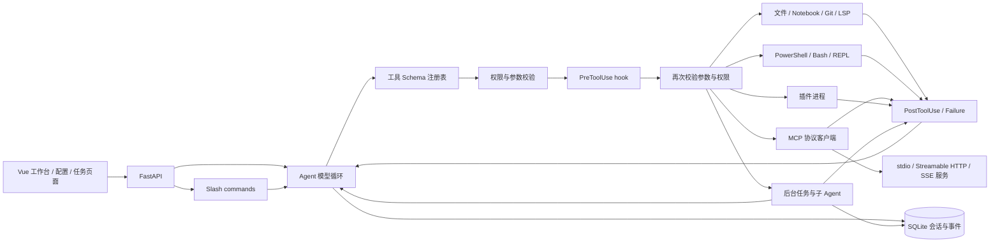
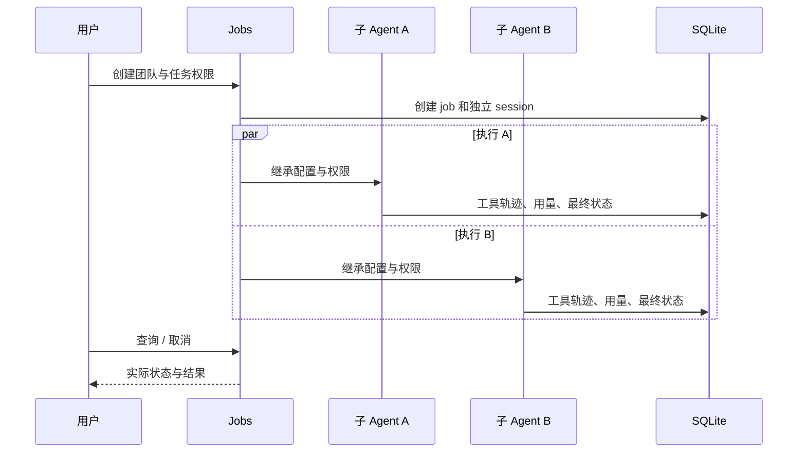
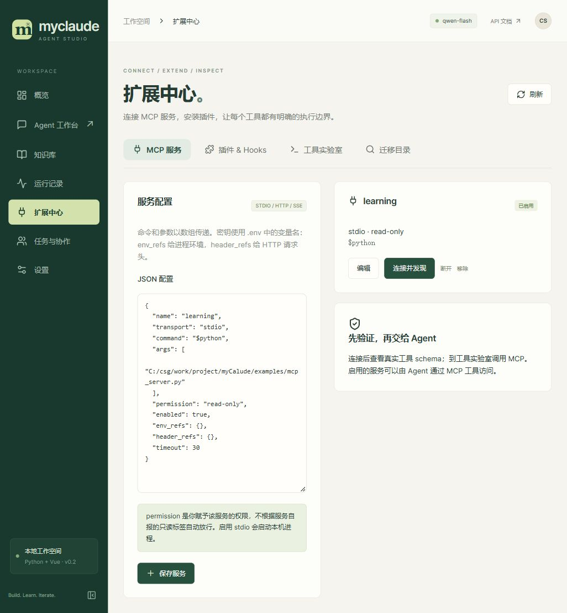
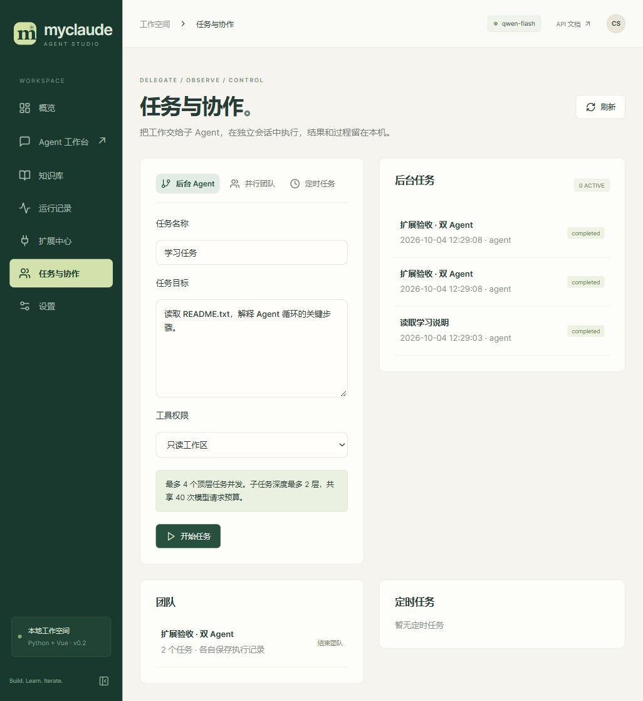

# 扩展开发与学习

适用版本：MyClaude 0.2。代码目录为 `C:\csg\work\project\myCalude`，不依赖 Rust 二进制。先读 `agent.py`，再用本篇的离线例子理解外部工具和任务调度，最后连接真实云模型。

## 一张图理解扩展层



学习重点是“模型只提出行动，运行时才决定是否执行”。工具是否出现在提示词中是一层约束，执行器再次验证权限才是实际边界。插件、MCP 服务及文件内容均不能自行扩大权限。

## MCP：先跑无需密钥的例子

进入「扩展中心 → MCP 服务」，保存以下配置并点「连接并发现」。`$python` 自动使用本项目虚拟环境解释器。

```json
{
  "name": "learning",
  "transport": "stdio",
  "command": "$python",
  "args": ["C:/csg/work/project/myCalude/examples/mcp_server.py"],
  "permission": "read-only",
  "enabled": true,
  "env_refs": {},
  "header_refs": {},
  "timeout": 30
}
```

该示例只提供加法、固定文本资源和提示词模板。真实第三方服务默认应使用 `danger-full-access`，先检查实现再决定是否赋予更低权限。服务的 `readOnlyHint` 只是声明，不用于自动放行。

发现结果包含：

- 工具 `add(a,b)`，实际返回数字；
- 资源 `learning://agent-loop`；
- 提示词 `explain_agent(topic)`。

工具实验室可执行：工具名 `MCP`，参数 `{"server":"learning","tool":"add","arguments":{"a":2,"b":3}}`。这个上游通用入口要求执行权限。经过发现的工具还会以 `mcp__learning__add_<hash>` 命名注入模型，使用配置中的服务权限，因此此例可以在只读对话里调用。

在工作台输入：“请调用 learning 的 add 工具计算 19+23，并根据实际结果回答。”执行轨迹应出现 MCP 工具而不是仅有模型心算。启用的服务在应用启动后后台发现；连接失败不会伪装成工具成功。

读取资源使用 `ReadMcpResource`；提示词可通过 `/api/mcp/{name}/prompts` 和 `/api/mcp/{name}/prompt` 获取。MCP 工具、资源与提示词是三类不同的协议对象：工具执行行动，资源提供内容，提示词提供模板。

HTTP 配置示例：

```json
{
  "name": "remote",
  "transport": "streamable-http",
  "url": "https://your-server.example/mcp",
  "permission": "danger-full-access",
  "enabled": false,
  "header_refs": {"Authorization": "MY_MCP_AUTH"},
  "timeout": 30
}
```

在本机 `.env` 设置 `MY_MCP_AUTH=Bearer <你的 token>`，不要把真实 token 写入 JSON、Git 或聊天。`env_refs` 同理：`{"SERVICE_API_KEY":"MY_SERVICE_KEY"}` 表示把 `.env` 中的后者传给子进程的前者。改变引用值后断开并重连。当前支持现有凭据和匿名连接；没有 OAuth 浏览器登录向导。`McpAuth` 返回连接和凭据配置状态，不表示完成了 OAuth 流程。

底层使用官方 Python SDK v1。连接的进入、请求循环和退出在同一个后台任务内完成，避免 AnyIO cancel scope 跨任务退出。可在 `mcp_client.py` 学习这种异步资源生命周期管理。[MCP Python SDK](https://github.com/modelcontextprotocol/python-sdk/tree/v1.x)

## 插件与 hooks：实际执行而非配置展示

在「插件 & Hooks」安装 `C:\csg\work\project\myCalude\examples\plugins\learning`，然后启用。

生命周期是：复制到 `.local/plugins` → 校验 manifest 和文件摘要 → 默认禁用 → 用户启用时执行 Init → 调用工具/hooks → 禁用或优雅停止时执行 Shutdown。已启用插件会在下次启动时执行 Init。文件被改动后会拒绝运行，需要重新安装审查后的版本。

插件通过 stdin 收 JSON，stdout 返回 JSON。普通文本输出可以作为工具结果，但 hook 必须返回对象。日志应写 stderr。插件命令是 argv，不默认通过 shell 展开；示例 `$python plugin.py count` 跨当前 Windows 路径工作。

```text
learning/
  .claude-plugin/plugin.json   # 名称、版本、工具、命令、hooks、生命周期
  plugin.py                   # stdin JSON -> stdout JSON
```

在工具实验室选择执行权限，调用 `plugin__learning__word_count`，参数 `{"text":"learn agent tools"}`，应得到 3 个词。工作台也可输入 `/learning:hello world` 验证插件命令。

前置 hook 收到 `hook_event_name`、`tool_name`、`tool_input`，后置/失败 hook 还会收到 `tool_response`。阻止工具示例：

```json
{"hookSpecificOutput":{"permissionDecision":"deny","permissionDecisionReason":"此操作不允许"}}
```

返回 `updatedInput` 可以改写输入，但改写后仍会再次校验 schema 和权限。`allow` 无法让只读任务执行写入。示例会拒绝写入 `.protected` 文件：调用 `write_file` 写 `test.protected` 会得到明确拒绝，文件不会创建。

因为本机进程没有 OS 沙箱，插件工具和 hooks 只在执行权限下运行；只读/写入模式不会执行这些 hook。因此 hook 是扩展逻辑，不是全局安全边界。不要把示例中的扩展名保护当作替代操作系统隔离的机制。

## 后台任务、团队与 Worker

「任务与协作」可创建只读、写入或执行权限的后台 Agent。每个任务有独立会话、运行记录、状态与结果。关闭页面不取消后台任务，点任务右侧停止按钮才会取消。任务发起 `AskUserQuestion` 时，该页显示回答表单；普通聊天中的问题出现在输入框上方。

模型工具的行为：

| 工具 | 行为 |
| --- | --- |
| Agent | 新建子会话，执行并等待结果；父任务中断时取消这个等待中的子任务 |
| TaskCreate | 创建后台 Agent，立即返回 task_id |
| TaskGet / TaskOutput / TaskList | 读取真实任务状态和持久化结果 |
| TaskStop | 取消后台任务；进程任务同时结束其拥有的进程树 |
| TaskUpdate | 任务结束后，在原会话追加指令；运行中先停止，避免并发写同一会话 |
| TeamCreate / TeamDelete | 创建 1–4 个任务或取消团队；结束团队保留任务历史 |
| RunTaskPacket | 将任务合同交给 Agent，repo 必须是当前工作区；策略文字不扩大权限 |
| Worker* | 有信任状态和固定会话的无终端 Worker，实际调用相同 Agent 执行器 |

最多 4 个顶层后台任务同时运行，队列最多 32。每棵任务树最多创建 8 个子任务、递归深度 2、最多 40 次模型请求。深层子任务不占用父任务正在持有的同一个信号量，避免所有父任务等待子任务时死锁；共享树预算仍限制规模。



子 Agent 使用同一模型连接，`Agent.model` 可改模型 ID，不需要额外 API Key；若要不同服务商连接，需要扩展 Provider 配置，当前不是多服务商路由器。团队任务共享工作区，不自动创建 Git worktree；并发修改同一文件需要自己划分路径或选择只读。

Worker 在 Python 版中是无界面的持久会话，不驱动原 Rust 的终端窗口。`WorkerObserve` 保存观察文本；`WorkerObserveCompletion` 仅附加报告，实际任务未结束时不能借文字将它改成完成。这个差异是明确的平台适配。

## 定时任务

Cron 使用五字段表达式和 UTC。`0 9 * * 1-5` 表示 UTC 工作日 09:00，即北京时间 17:00。调度记录持久化，下次到期时间和上次任务 ID 可在页面看到。

调度器只在应用运行期间每 5 秒检查到期任务。不补跑停机期间的每个遗漏周期；上次任务仍在运行时跳过本周期。应用重启后未正常结束的旧任务标记为 interrupted，不自动恢复执行。这里实现的是应用自己的调度器，不会创建 Windows 计划任务或 Codex 自动化。本次验收没有留下真实定时任务。

## Shell、Git、LSP 和命令

PowerShell、Bash、REPL 需要执行权限。每次 REPL 是独立 Python/JavaScript 进程，不保留变量。超时参数以毫秒计，最长 900 秒；stdout/stderr 各保留 128 KB，同时继续排空管道避免阻塞。Windows 优先使用 Git Bash；缺失执行器时明确失败。

进程 cwd 不是 OS 沙箱。`filesystemMode=workspace-only`、网络隔离和命名空间隔离等参数无法在此执行器兑现时会直接拒绝，绝不显示“已隔离”。环境变量使用允许列表，不自动继承 LLM 密钥；执行权限仍能访问当前 OS 用户可访问的磁盘和网络。

Git 查询关闭外部 diff/textconv/pager，revision 与路径分开验证。Python LSP 实际启动 pylsp，通过 Content-Length JSON-RPC 请求 symbols、references、definition、hover、diagnostics、completion、formatting；行和字符均从 0 开始。其他语言可在“会话与运行时 → 工具策略”配置 `lsp_servers`，例如 `{"rust":["rust-analyzer"]}`；需本机已安装对应服务器，尚未逐语言实测。

Slash commands 可在聊天框和 CLI 使用。115 个入口中，`/review`、`/fix` 等 17 个是明确的 Agent 工作流；`/mcp`、`/plugin` 无参数时在 Web 打开管理页面，有子命令时执行本地操作，例如 `/plugin list`、`/mcp discover learning`。`/undo` 和 `/rewind` 仅撤回会话轮次，不撤销已经写入的文件。`/effort high`、`/reasoning high` 设置 OpenAI 兼容模型的 `reasoning_effort`；`/fast` 调整 Agent 轮数。命令目录标记“可用 · 等价核验中”，不能据此声称全部 CLI 行为兼容。

## 推荐的源码阅读与练习顺序

1. `providers.py` → `agent.py`：看流式响应如何拼成一次完整工具调用，以及结果如何进入下一轮消息。练习让模型读文件再解释。
2. `tools.py` → `extensions.py` → `execution.py`：看 schema、路径、权限、超时如何分别生效。练习在只读模式请求写文件，确认副作用被拒绝。
3. `mcp_client.py` + `examples/mcp_server.py`：把加法工具改成一个不需要密钥的小业务查询，观察发现、调用、重连。
4. `plugins.py` + `examples/plugins/learning`：添加自己的统计工具，再写一个会拒绝操作的前置 hook；检查拒绝后文件是否存在。
5. `jobs.py`：重点看任务状态、会话锁、取消清理、父子预算和信号量。练习并行两个只读分析任务，然后取消一个。
6. `rag.py`：理解 embedding 空间、命名空间过滤、Qdrant 与本地回退；不要把数据库可连接等同于检索质量好。
7. `backend/tests/test_extensions.py`：看真实 MCP/插件/语言服务测试如何与模拟云模型搭配。为新工具写“错误输入是否产生副作用”的测试，比只检查返回字符串更有价值。

对于 AI 应用开发，最值得学习的是协议适配、上下文管理、工具执行边界和可观察性；对于 Agent 开发，再加上任务预算、取消传播和状态恢复。框架或语言只是承载这些机制的方式。

## 页面实测截图




