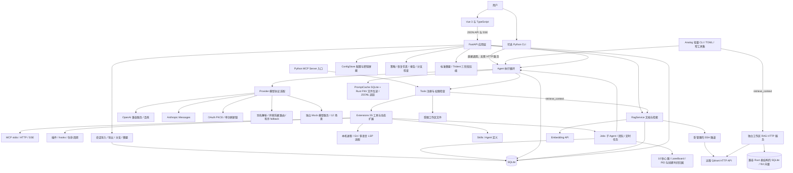
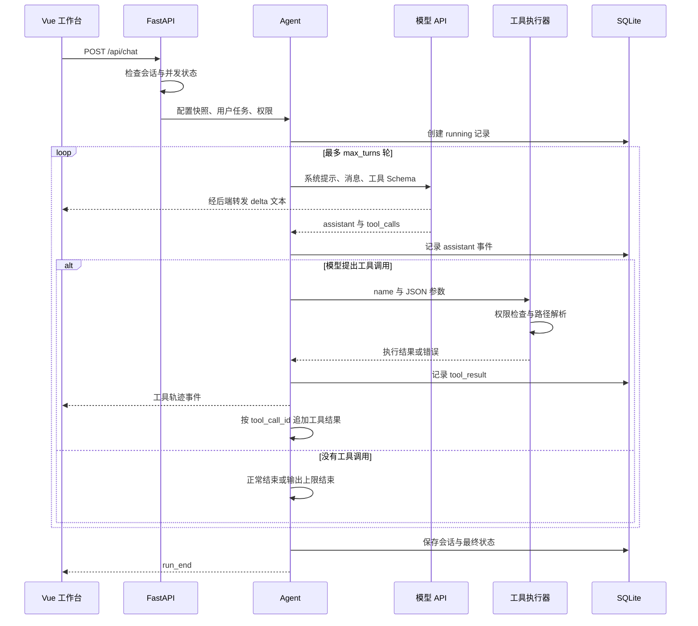
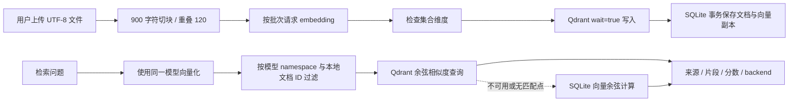
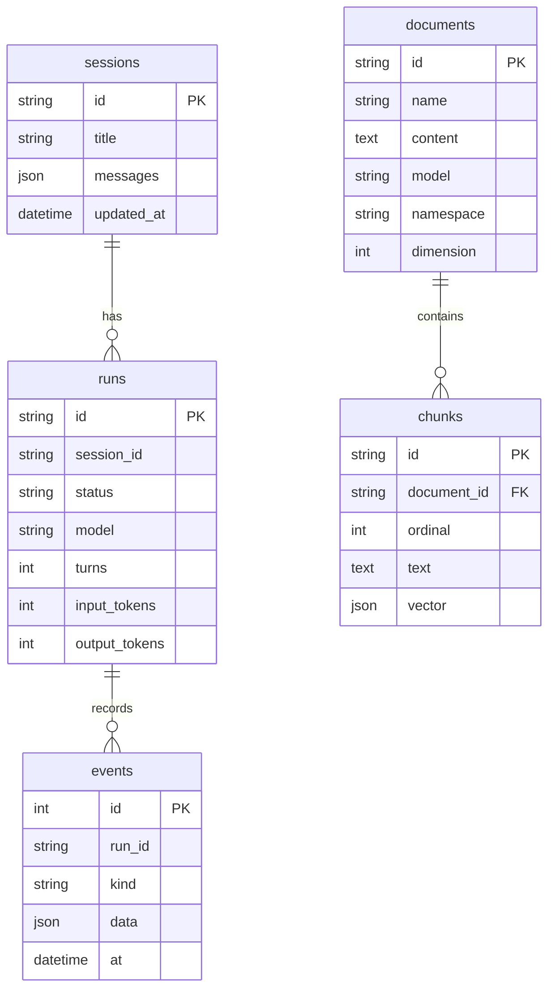
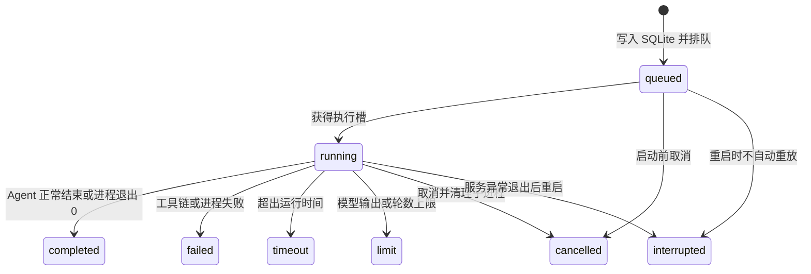

# MyClaude 架构设计

本项目把 Claw Code 的核心 Agent 流程重组为 Python 服务，并增加 Vue 操作界面。设计重点是让模型协议、执行循环、工具副作用和持久化各自有清晰边界，便于学习和扩展。支持本机运行和服务器单用户部署；服务器入口由 HTTPS 与独立密码保护。迁移基线是冻结的 Claw Code 源码，兼容边界见迁移进度文档。

## 系统结构



生产构建只有一个本机服务：FastAPI 同时托管 Vue 静态文件与 `/api`。开发模式下 Vite 提供热更新，并代理 `/api`。Vue 不直接持有服务商 API Key，也不直接连接 Qdrant。

当前真实连接是百炼 qwen-flash 与 text-embedding-v4。Qdrant 使用新的 `myclaude_learning_v1` 集合和本机 17333 转发端口，与原 Rust 学习环境分开。

## 模块责任

| 文件 | 责任 | 不承担的工作 |
| --- | --- | --- |
| `backend/app/main.py` | 路由、参数校验、SSE 响应、生命周期、静态页面 | 不组织模型内部循环 |
| `backend/app/config.py` | 配置默认值、首次读取 .env、校验、原子保存、密钥屏蔽 | 不调用模型 |
| `backend/app/agent.py` | 消息累积、流式事件、工具循环、预算、会话提交、终止状态 | 不实现供应商请求格式 |
| `backend/app/providers.py` | OpenAI 与 Anthropic 协议转换、SSE 聚合、embedding | 不决定文件权限 |
| `backend/app/tools.py` | 工具 Schema、可用工具列表、权限及路径检查、文件操作 | 基础文件实现；扩展路由在 extensions.py |
| `backend/app/rag.py` | 切块、向量化、入库、过滤、检索、显式回退 | 不生成自然语言答案 |
| `backend/app/db.py` | SQLite 表、事务、会话与事件读写 | 不保存供应商密钥 |
| `backend/app/tunnel.py` | 启动、复用、结束本进程拥有的 SSH 隧道 | 不修改远程 Kubernetes 部署 |
| `backend/app/cli.py` | 独立启动同一组 Python 服务、命令、REPL | 不依赖 HTTP 服务，不另建 Agent 循环 |
| `backend/app/mcp_server.py` | 将当前权限内的工具暴露为 MCP stdio 服务 | 不自动开启定时调度 |
| `backend/app/oauth.py` | PKCE、state、凭据原子存储、刷新互斥 | 不把令牌返回 Vue |
| `backend/app/sessions.py` | Rust 会话互通、工具配对校验、分支、摘要 | 导入不覆盖原会话 |
| `backend/app/assets.py` | 用户/工作区技能、Agent 定义及来源 | 不自动执行技能内脚本 |
| `backend/app/config_layers.py` | 启动时五层配置覆盖、来源追踪；显式保存导入 | 自动加载只应用已支持字段；未映射字段在报告中保留 |
| `backend/app/policy.py` 与 `hooks.py` | 工具范围、参数规则、用户确认、前后置 Hook | 规则不能扩大会话最高权限 |
| `backend/app/orchestration.py`、`recovery.py`、`reports.py` | 规则求值、审批账本、恢复次数、报告投影 | 策略求值不会自动执行 Git 合并 |
| `backend/app/git_context.py` 与 `usage.py` | 真实 Git 状态、基线检查、用量/显式单价计算 | 冻结的兼容价格不是当前云账单 |
| `frontend/src/api.ts` | JSON 请求和分帧解析 SSE | 不执行工具 |

Vue 页面按组件划分：`App.vue` 提供框架与概览；`ChatPanel`、`KnowledgePanel`、`RunsPanel`、`SettingsPanel`、`ExtensionsPanel`、`TasksPanel`、`RuntimePanel` 分别对应业务页面。`Markdown.vue` 使用 marked 渲染，并通过 DOMPurify 清理模型返回的 HTML。

## 一次 Agent 请求



**模型只提出动作，Python 执行器才产生真实副作用。** 模型返回 `write_file` 并不等于写入成功；工具必须再次验证权限和路径，然后执行，结果才会回到模型。工具错误也是上下文，模型可以据此修正参数或解释失败。

同一个会话不能同时运行两次。不同会话可以独立运行；每次开始复制配置快照，避免同一请求中途换模型。设置保存会在 Agent 或入库运行时拒绝修改。

当前保留 55 个上游工具名称与输入 schema，另有 `list_files`、`search_files`、`retrieve_context` 三个原 Python 版工具，以及发现后的动态 MCP/插件工具。按有效权限过滤后再发给模型，执行器仍会再次检查。文件内容和检索片段作为资料进入上下文，系统提示明确它们不能覆盖用户任务；这不等于已解决所有提示注入问题。

## 流式模型协议

内部消息使用接近 OpenAI 的统一结构：`role`、`content`、`tool_calls`、`tool_call_id`。Provider 输出两类事件：

```text
delta     流式文本片段，用于即时显示
complete  完整 assistant 消息、工具调用、usage、stop reason
```

OpenAI 适配器按工具 `index` 合并 ID、函数名和 JSON 参数碎片，处理百炼返回的空值字段。工具参数只有在完整响应到达后才解析和执行。缺少结束事件时，不能将网络截断当作正常回答。

Anthropic 适配器把消息转换成 text、tool_use、tool_result blocks，并合并相邻同角色消息；返回的流也规范化成同样的内部事件。增加第三种协议时，应实现适配器，而不是在 Agent 主循环中加入供应商判断。

网页通过 `fetch` 读取 POST SSE 流。`api.ts` 使用 TextDecoder 保留多字节文本边界，再按空行划分事件；没有收到 `run_end` 时报告连接中断。取消请求会触发后端取消流程。

## 上下文与终止状态

完整会话保存在 SQLite，发送模型前可以裁剪历史。当前使用字符预算近似限制，而非 tokenizer 精确计数。裁剪以用户轮次为单位，保留 assistant tool_calls 与 tool results 的配对。如果当前单轮已经过大，则明确失败，而非无界增长。

Agent 同时限制最大轮数和总时长。达到轮数、输出上限、超时或取消都会记录不同状态；不会像某些示例循环一样，把耗尽预算标为成功。

完整运行的消息提交为后续上下文。发生取消、超时或错误时，本次半成品消息不作为后续上下文，只留下用户任务与“运行未完成”的说明；已经执行的操作及事件仍保存在运行轨迹中。文件写入无法通过取消自动撤销。

服务重新启动时，数据库把遗留 running 记录标为 interrupted。这只是状态恢复，不会自动重放工具或恢复执行。

## RAG 数据流



每个 chunk 使用独立 UUID，避免不同本地数据库用自增整数覆盖同一远程点。向量模型地址与 ID 的哈希构成 namespace，保证不同模型的向量不混查。查询还过滤当前本地文档 ID，避免把集合里的其他资料读出来。

写入先确保 Qdrant 成功，再在 SQLite 中发布文档。若 Qdrant 成功后进程恰好在本地事务提交前退出，远端可能留下无本地记录的点；当前查询的文档 ID 过滤会排除它们。生产化时可加入 outbox、入库任务表和清理机制，不能声称这里实现了跨数据库原子事务。

SQLite 保存向量副本，因此远程故障时可以在本机用余弦相似度降级。响应明确返回 `sqlite-fallback` 和 warning。该路径是线性扫描，适合小型学习知识库；大规模数据应增加异步检索、索引维护与检索效果评估。

RAG 本身只返回片段。Agent 通过 `retrieve_context` 拿到结果后，再调用对话模型生成回答；独立的检索页面则直接展示片段，方便定位“检索错误”还是“生成错误”。

## 数据模型



图中的 sessions/runs/events 为应用层逻辑关联，数据库仅为 chunks/document_id 设置外键级联。SQLite 启用 WAL 与 busy timeout。每次读写使用短连接和事务，适合当前规模；没有将同步数据库调用伪装成异步数据库。

配置独立存放在 `.local/settings.json`，不放进消息表。保存通过临时文件原子替换，空密钥输入保留旧值。源 `.env` 只用于第一次初始化；ASR/TTS 等无关字段不导入。

## API 与事件契约

| API | 用途 |
| --- | --- |
| GET `/api/overview` | 概览统计与工具定义 |
| GET / PUT `/api/settings` | 读取屏蔽密钥后的配置、保存配置 |
| POST `/api/connections/{llm,embedding,qdrant}` | 测试已保存连接 |
| GET / POST `/api/sessions` | 列出、创建会话 |
| GET `/api/sessions/{id}` | 恢复完整会话消息 |
| POST `/api/chat` | 启动一次 Agent，返回 SSE |
| GET `/api/runs`、`/api/runs/{id}` | 运行列表及事件详情 |
| GET / POST `/api/documents` | 文档列表、multipart 上传入库 |
| POST `/api/retrieve` | 独立语义检索 |

聊天事件依次包括 `run_start`、`turn_start`、`delta`、`assistant`、`tool_start`、`tool_result` 和 `run_end`；可选 `context_trimmed`、`error`。高频 delta 不单独落库，完整 assistant 和工具事件会落库。

## 学习顺序

1. 先读 `agent.py` 和 `test_agent_real_tools_and_persistence`：理解两轮模型调用如何完成一次读文件。
2. 读 `tools.py`：观察 JSON Schema、参数解析、权限检查与真实副作用如何衔接。练习添加一个只读统计工具。
3. 读 `providers.py` 及分片流式测试：理解接口兼容不只是换 URL，还涉及 stop reason、usage、空值和工具参数分片。
4. 读 `db.py` 与 Vue 运行记录页：学习把一次任务变成可观察、可追溯的数据，而非只显示最终回答。
5. 读 `rag.py`：区分 embedding、向量数据库、召回和模型生成；建立一组已知答案问题评估命中率。
6. 再阅读 MCP、插件和子 Agent 模块。对照新增示例，观察协议会话、hooks、父子权限与共享预算如何复用核心执行循环。

## 当前边界

当前是本机单用户应用，尚未实现用户认证、多租户、混合检索和 reranker。主网页知识库与独立工作区索引是两个入口，后者支持增量更新和删除过期文件索引。Linux namespace/network 隔离可探测并按请求启用；当前 Windows 主机不支持该隔离，文件系统隔离请求会明确拒绝。模型 OAuth 已有 PKCE 与刷新；MCP 专用 OAuth discovery 尚未接入。原 Rust 的全部契约仍在核验，见《全量迁移进度》。

## v0.4 中值得学习的运行时设计

`process_owner.py` 使用 PID 和进程创建标识一起确认归属。Web 重启只恢复死亡执行器的任务，不会把仍运行的 CLI 标成中断。PID 会复用，因此仅检查“进程号存在”是不够的。

`providers.py` 仅在尚未输出响应时进行重试或切换模型。一旦流已经输出，再自动重放可能导致用户看到重复回答，或让工具副作用被重复执行。备用连接通过环境变量名引用密钥；厂商路由缺少对应凭据时不会拿另一个厂商的密钥代替。

`agent.py` 在上下文过长或上轮输入超过阈值时，给模型构建摘要上下文，SQLite 的完整历史仍保留。网页手动压缩则修改选中会话，应先创建分支。`trident.py` 把 assistant 的整组 tool_calls 和结果作为原子单元，避免在压缩时拆散配对。

MCP 健康来自当前连接和阶段事件，历史成功不代表现在仍在线。注册、连接、握手、发现、调用、关闭均有证据；重试只用于启动阶段，不自动重放工具调用。本地追踪写入失败也不会中断实际 Agent 工作。

技术参考：[FastAPI 响应与 StreamingResponse](https://fastapi.tiangolo.com/advanced/custom-response/)、[FastAPI 生命周期](https://fastapi.tiangolo.com/advanced/events/)、[Vue TypeScript](https://vuejs.org/guide/typescript/overview)、[Vite 开发与构建](https://vite.dev/guide/)。实际行为以本项目代码和测试为准。


## v0.2 扩展层与任务状态

| 模块 | 责任 |
| --- | --- |
| `catalog.json` | 固定上游 commit 的 55 个工具 schema 和 140 个命令元数据 |
| `extensions.py` | 扩展分派、二次参数校验、文件/Git/Notebook/Web 工具、Worker 状态适配 |
| `execution.py` | 权限等级、ContextVar 运行上下文、进程环境/输出/超时/取消 |
| `mcp_client.py` | MCP 连接生命周期、凭据环境变量引用、发现/调用/资源/提示词 |
| `plugins.py` | manifest、文件摘要、安装启停、stdin/stdout 协议、hooks 与生命周期 |
| `jobs.py` | SQLite 任务状态、后台协程、并发限制、父子预算、UTC 调度 |
| `lsp.py` | pylsp 子进程与标准 JSON-RPC 请求 |
| `commands.py` | 命令分类、原有别名、会话操作、页面动作与 Agent 提示工作流 |
| `extension_api.py` | 扩展管理、工具实验室、任务/团队/定时/问题 API |
| `backend/run_server.py` | 受管理的 Uvicorn 启动与优雅停止 |

`Tools` 保留原有基础工具接口，扩展版将调用交给 `Extensions`。`Agent` 只负责调度工具，不关心工具究竟是 Python 函数、MCP 远程服务还是插件进程。动态 MCP 名称包含服务名与短 hash，避免与本地工具冲突。



新增 `jobs` 表保存 kind、status、parent_id、session_id、payload、result 和时间；`extension_state` 保存类型化的 MCP/插件/Worker/团队/定时/Todo 等记录。运行细节继续写既有 `runs` 与 `events` 表，旧会话不迁移、不清空。

执行权限模型为 read-only < workspace-write < danger-full-access。计划模式将有效权限临时收窄为只读；退出计划模式仅恢复本次运行原先获得的权限。子任务继承父权限，TaskUpdate 取原任务权限与当前权限的较低值。第三方 MCP 自报的只读标签不参与授权。

当前任务队列是单个 Python 服务进程内的 asyncio 调度。SQLite 保存的是状态和结果，不是可跨进程恢复的协程快照。不要用多个 Uvicorn worker 同时运行此版本；若要分布式执行，应引入独立队列、原子认领、租约和幂等机制。

扩展流程、例子和实践顺序见 [扩展开发与学习](扩展开发与学习.md)。
