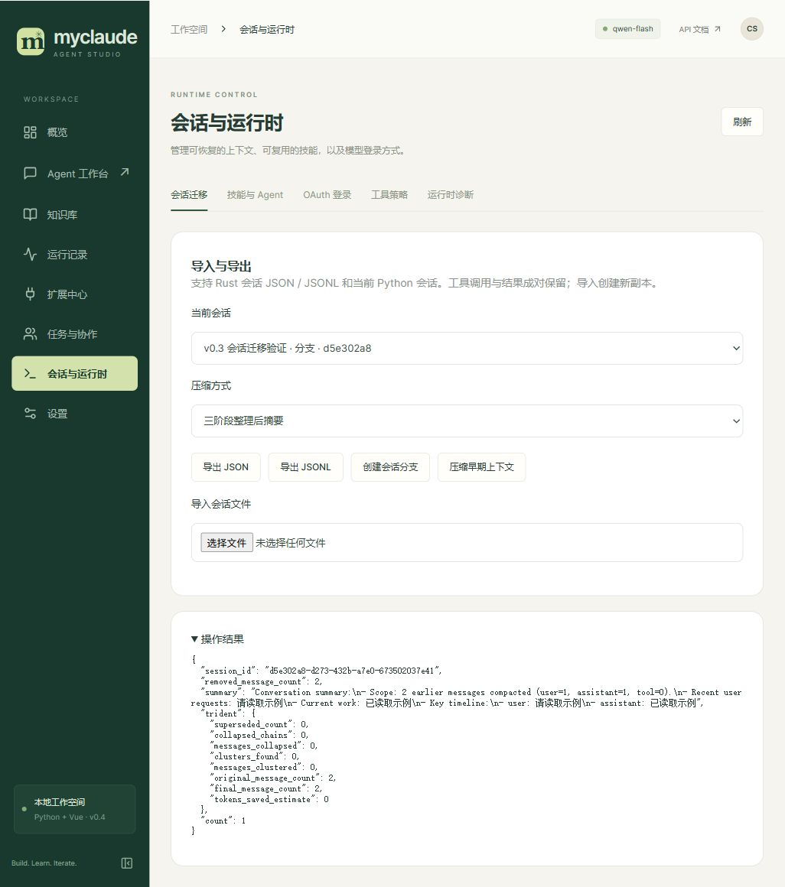

# MyClaude 0.4 迁移与验收

目标目录：`C:\csg\work\project\myCalude`。原项目目录：`C:\csg\work\project\claude`，冻结基线 `08106b0c3771ef5b4a5aa176acccd460e88b7325`。

目前 11 个 crate 的主要职责都有 Python 对应实现和入口，Vue 使用同一套 runtime。**原版全参数、全输出与所有边界行为尚未全部等价验收**，准确范围见 [全量迁移进度](全量迁移进度.md)。原 `.env` 未改写。按用户授权，服务器首次模型配置通过 SSH 写入 Kubernetes Secret；密钥未进入 Git 或镜像。

## 本轮验收结果

| 验收 | 结果 | 证据 |
| --- | --- | --- |
| 后端完整回归 | 121 通过，1 跳过 | `.local/tests-release.log` |
| 模型场景端到端 | 原 12 场景全部通过真实 Python Agent/工具 | `backend/tests/test_mock_end_to_end.py` |
| Python 静态检查/格式 | 通过 | Ruff |
| Vue TypeScript/生产构建 | 通过 | `frontend/dist` |
| 原 Rust 恢复 Python 历史 | JSON/JSONL、普通/压缩共 4 项通过 | `.local/rust-interchange-v04.json` |
| 独立 RAG/Mock 子进程 | 启动、索引、查询、Messages 成功，0 云请求 | `.local/standalone-services-v04.json` |
| 当前云模型 | read_file 成功，两轮返回 MYCLAUDE_V04_TOOL_OK | `.local/cloud-tool-v04.json` |
| 浏览器 | 测试分支、Trident、备用模型控件、心跳展示正常，错误日志为空 | `docs/images/runtime-v04.png` |
| 服务 | http://127.0.0.1:8000，健康版本 0.4.0 | `/api/health` |

跳过项是 Windows 符号链接创建权限；两条第三方依赖弃用提示不影响结果。更新前状态备份位于 `.local/backups/pre-v04-*`。此前 Qdrant、MCP、团队实测记录仍保留，不将旧证据冒充本轮全部重测。

## 兼容边界

主 CLI、Analog 和 Vue 共享核心执行代码，Python 的 JSON envelope 和持久化布局有重构差异。会话导入创建副本；手动压缩改变选中会话，建议先分支。自动摘要用于模型输入，完整历史保留在 SQLite。

Linux namespace/network 实现具有探测和失败拒绝；Windows 没有 AppContainer；Linux 宿主机 namespace/network 包装已真实运行通过，也不宣称文件系统沙箱。插件与 shell 仍按本机 OS 用户执行。本机默认只监听回环地址；服务器容器监听 8000，经 Traefik TLS + Basic Auth 访问，是单用户实例。

Web 与 CLI 可并行使用不同会话；任务恢复核对 PID 和进程创建时间，同一会话仍由 SQLite 互斥。团队共享工作区，没有自动 Git worktree 分配或分布式调度。

分层配置在进程启动时生效，支持字段覆盖当前设置；未映射字段保留在诊断报告，显式导入遇到未映射项会拒绝保存。MCP 支持私密环境/请求头引用，尚未云联调的认证与平台能力见进度文档。

策略/恢复诊断保留原模块的仿真语义，不把建议动作说成已执行。原 ACP 是占位状态，不属于漏写的实际编辑器服务。

## 复现

```powershell
cd C:\csg\work\project\myCalude
./.venv/Scripts/python.exe -m pytest backend/tests -q
./.venv/Scripts/python.exe -m ruff check backend scripts examples
./.venv/Scripts/python.exe -m ruff format --check backend scripts examples
./.venv/Scripts/python.exe scripts/verify_standalone_services.py
./.venv/Scripts/python.exe scripts/verify_rust_interchange.py --rust C:/csg/work/project/claude/rust/target/debug/claw.exe
cd frontend
npm.cmd run build
cd ..
./start.ps1
```

真实云调用会计入云服务用量；自动测试使用模拟模型。独立程序配置见 [独立程序与模型路由](独立程序与模型路由.md)。




部署新增 Host/Origin/子路径测试；真实 Rust/Python RAG SQLite 双向互读也已通过，见 `.local/rag-interchange.json`。
